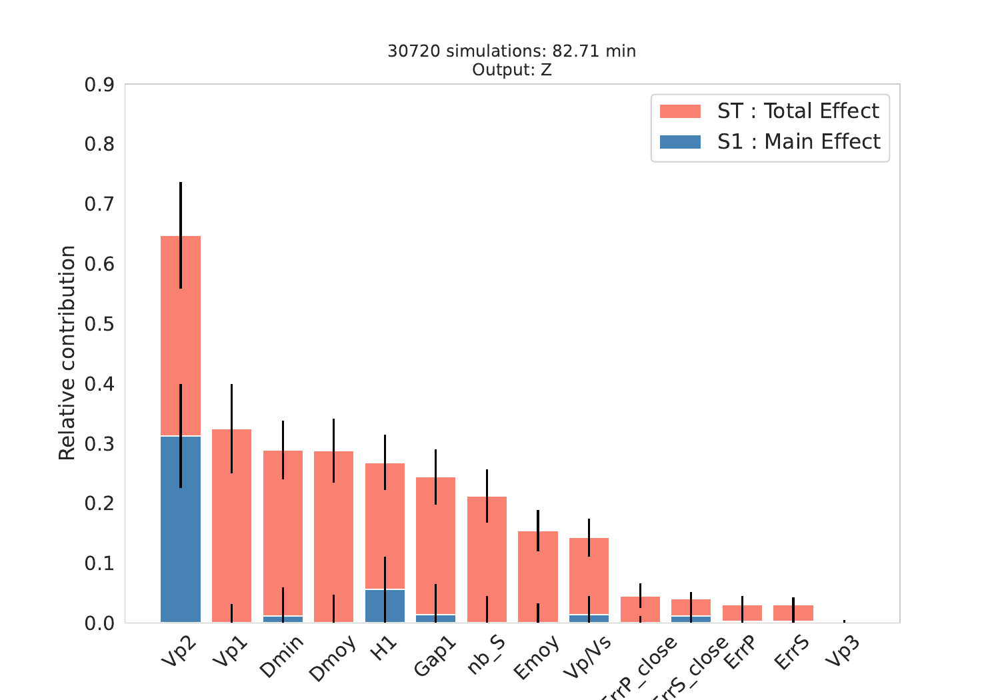

## b-Bayesian

Bayesian transdimensional inversion of the temporal variations of the b-value and of earthquake detectability, from complete (non-truncated) seismic catalogs.

- **Code:** [github.com/Marine-Laporte-seismo/b-Bayesian](https://github.com/Marine-Laporte-seismo/b-Bayesian)
- **Latest version:** [v4.0 – new McMC with magnitude binning](https://github.com/Marine-Laporte-seismo/b-Bayesian/releases/latest)
- **Paper:** Laporte et al., *JGR Solid Earth* – [doi:10.1029/2024JB029973](https://doi.org/10.1029/2024JB029973)

Written in Fortran, with Python scripts for the creation of synthetic catalogs and for the figures.

## GSA_loc

*Results of Sobol indexes for an earthquake located at 15km depth in a 1D velocity model using hypo71 algorithm to quantify the effects of a varying network geometry, errors in the velocity model and uncertainties in phase picking.*

Global sensitivity analysis for understanding earthquake location uncertainties for an earthquake location using NonLinLoc algorithm in a specific network geometry with a 1D velocity model. The code returns the Sobol indexes characerizing the individual and combined effects of network geometry parameters/velocity model errors/picking uncertainties on the final known location. This code does not computes the location uncertaities of a given earthquake catalog, it only informs on the various effects of velocity model errors and network geometry on a synthetic earthquake location

- **Code:** [github.com/Marine-Laporte-seismo/GSA_loc](https://github.com/Marine-Laporte-seismo/GSA_loc)
- **Paper:** Laporte et al., *Geophysical Journal International* – [doi:10.1093/gji/ggae093](https://doi.org/10.1093/gji/ggae093)

Written in Python. 